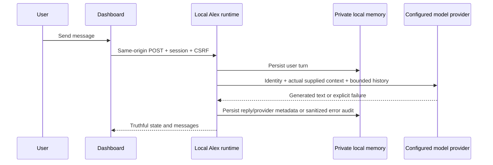

# Alex integration architecture

## Inspection and intended integration

Inspected the root/dashboard README files, PROJECT_STATUS.md, CHANGELOG.md, App.tsx, OfficeScene.tsx, Vite/PWA configuration and package scripts. No AGENTS.md exists in the workspace or ancestor paths. The existing app is React 19 + React Three Fiber/Three.js, Vite and TypeScript. It has seven local employee records, sample activity/tasks, scene selection and camera controls. There is no existing agent runtime, chat, backend, provider abstraction or persistent memory to reuse. No provider credentials/model settings were found in the process environment. The current implementation must remain usable without a provider.

The integration will keep the office/dashboard and add a same-origin API proxied by Vite to a loopback Node server. Alex's identity and scene/team context will be server-owned, with a model-neutral conversation contract and replaceable provider registry. The first two transports will be OpenAI-compatible Chat Completions and Ollama. Server configuration, never browser inputs, defines provider URLs and credentials. No arbitrary command or external-action executor will exist.

Structured local storage will separate preferences, transcript, project context, relationships/inside jokes and temporary task context from the versioned identity. Messages and important actions will be persisted atomically. User-editable memory will be explicit and reviewable; dialogue alone will not silently become a verified project fact. Chat history persists even when only a recent bounded window fits in a model prompt.

The Sophia adapter will queue user-approved requests with correlation IDs and report `unavailable` until a real adapter is installed. It will expose typed update contracts without synthetic task progress. Proactive messaging will use persisted real events, deduplication, quiet hours, daily briefing settings and a minimum interval. It will run only while the server is running, and appear in the in-app chat; no OS push integration is implied.

Security boundaries: local single-user runtime, loopback backend, same-origin requests, browser session cookie + CSRF token, JSON-only bounded input, server-side provider allowlist, model timeouts, one generation at a time and sanitized errors/audit records. Provider output is plain text and cannot invoke tools. Consequential execution stays unavailable; future executors must enforce per-action approval independently of model text.

## Provider request reference

OpenAI-compatible transport uses `POST /chat/completions` with `model`, ordered `messages`, and non-streaming output. Identity is supplied every turn separately from persisted messages. Verified against [official OpenAI Chat Completions reference](https://developers.openai.com/api/reference/resources/chat/subresources/completions/methods/create). Capability metadata describes this adapter, not a claim that every server supports every model feature. A successful inference is required before online status is shown.

## Implemented components

| Component | Responsibility |
| --- | --- |
| `src/team.ts` | Shared seven-person roster and explicit authored scene context. Six colleagues remain placeholders. |
| `server/identity.ts` | Versioned Alex identity, original personality, seriousness/humor rules, truthful capability and context boundaries. No fixed jokes or canned conversational fallback. |
| `server/providers.ts` | `ModelProvider`, bounded/timeout-protected HTTP adapters, optional model discovery and allowlisted `ModelRouter.select()` seam for future Nexus. |
| `server/memory.ts` | Schema-validated private JSON persistence, atomic serialized writes, contextual retrieval, events and audit. |
| `server/runtime.ts` | Conversation lifecycle, user-controlled memory/settings, local handoff queue and notification generation. Single in-flight generation; local setting changes roll back on write failure. |
| `server/sophia.ts` | Unavailable adapter, correlated request/update types, approval requirement and trusted-adapter update validation. No production dispatcher is installed. |
| `server/notifications.ts` | Deterministic timezone/quiet-hour/interval/day/deduplication rules. |
| `server/http.ts` | Local API boundary, bounded JSON input, session cookie, CSRF, origin/host checks, request pacing and sanitized errors. |
| `src/useAlex.ts`, `src/AlexChat.tsx` | Polling connection state, interactive chat, explicit saved memory, preferences, model switch/test, queue and action log. |
| `scripts/serve.mjs` | Runs loopback agent API and existing Vite dev/production preview together; forwards shutdown and fails if either process exits. |

## Memory and context contract

`apps/dashboard/.local/alex/alex.json` is ignored by Git. Its schema version is separate from the identity version. Default directory/file permissions are 0700/0600, and a PID lock prevents concurrent runtimes from writing the same store. It is local plaintext, not encrypted or a multi-user database. Preserve/backup it privately if moving the application. A custom `ALEX_DATA_DIR` must be protected and excluded from source control by the operator.

- **Identity/permanent personality:** versioned server source, resent each turn; never learned from provider output.
- **User preferences:** humor, communication instructions, timezone, quiet hours, notification interval and daily briefing settings; edited explicitly in Settings.
- **Conversation:** full timestamped user/assistant transcript, message kind and selected provider/model metadata. Saved across restarts and provider switches. UI shows latest 200 messages; each inference includes latest 32 turns plus up to four relevant older turns selected by keyword overlap. Content is bounded per message, so context is not perfect recall.
- **Project context:** explicitly user-saved notes, distinct from the local PROJECT_STATUS.md document snapshot. Notes are labeled user reports; neither is live task telemetry.
- **Relationships/inside jokes:** explicit user-saved notes derived from real history. They are not invented facts about colleagues. No automatic unreviewed memory extraction occurs.
- **Temporary task context:** independently editable/removable notes; “temporary” describes purpose, not automatic expiry. Users remove notes when finished.
- **Events/queue/audit:** real runtime starts, explicit provider selection and approved local handoff queuing. No synthetic coding incidents or task completions. Recent bounded events/audit appear in the Log tab.

Older turns may be retrieved when relevant; ordinary history is not silently converted into durable verified facts. Use Save memory and Save preferences for reliable explicit retention. The user can remove individual notes. The current single-user implementation has one continuous conversation and no encrypted vault, semantic vector store or automatic summary of the entire transcript.

## Provider and connection behavior

Server-only `.env.server` or process variables select an accessible text-chat model. OpenAI-compatible models use `max_completion_tokens`; gateways must support that request field. Ollama uses `/api/chat` with `stream: false` and `options.num_predict`. Optional discovery uses `/models` or `/api/tags`; absence of model-list support is tolerated. Discovery is advisory because gateway aliases may differ. Adapter capability flags advertise the implemented runtime surface: text only, no tools/images/streaming. They do not assert hidden model capabilities. [Ollama chat reference](https://docs.ollama.com/api/chat) and [model listing reference](https://docs.ollama.com/api/tags).

No default paid model is chosen. No provider is marked online at startup or merely because a key exists. A successful real inference changes state to online; this means **last request succeeded**, not a continuous provider heartbeat. Thinking/error/offline states and sanitized error details are exposed. Test real connection performs a real inference and stores its response. Requests time out at 60 seconds per provider HTTP call. Probe discovery plus inference can take up to 120 seconds. Empty, malformed, oversized, tool-only and explicitly truncated responses are rejected. Provider responses are rendered as plain text, without HTML execution. Provider changes preserve local transcript/notes and reset connection verification.

All generation paths use the same identity and context assembly. Changing providers cannot intentionally remove Alex’s identity rules, although actual behavior and instruction adherence depend on the chosen model. Semantic personality consistency/humor quality require live-model evaluation; deterministic tests verify the supplied contract, not the intelligence of test fixtures.

## Sophia and consequential actions

The UI accepts an exact task request or clarification and requires a separate approval checkbox before storing it. Editing the text/type clears approval. Its state is `awaiting_adapter`, and the UI explicitly states it is not delivered or executed. Nothing in chat can trigger that queue mutation. There is no pretend Sophia response or generated task progress.

A future trusted dispatcher can implement `SophiaAdapter.submit()` and `updates()`, preserving correlation IDs and user requirements. `applySophiaUpdate()` rejects unknown IDs, undelivered/terminal requests and backward transitions. The current runtime never calls a live adapter. Installing a future dispatcher also requires a reviewed dispatch permission flow: this implementation's checkbox authorizes **local storage only**, not future automatic execution/delivery. Future consequential tools must enforce action-specific approval server-side; a model saying “approved” is not authorization. No arbitrary shell/file/deployment executor exists.

## Proactive communication

Defaults: proactive updates and daily briefings off, minimum interval 60 minutes, quiet 22:00–08:00 Asia/Manila. Interval is configurable between 15 and 1440 minutes. The server checks once per minute while running. Quiet hours may cross midnight; equal start/end disables them. Scheduled briefings require proactive permission, run at most once per local date after the configured time, and respect quiet hours/intervals. There is no missed-day replay backlog.

Proactive replies summarize real pending events or the supplied project context using the configured model. Event IDs and last delivered briefing day are persisted only on success. Failed attempts remain pending and have at least a five-minute retry backoff. Generated briefings/updates appear in chat, with an unread count on Talk to Alex; the browser stores only a read timestamp for this badge. No OS push, background Android service or scheduler while Termux is stopped is provided. Enabling proactive communication permits provider calls/costs; the UI states this.

## API and operational boundary

`GET /api/alex` returns current public state/history and issues a short-lived HttpOnly SameSite=Strict cookie plus CSRF token. `POST /api/alex` accepts only documented JSON actions (chat, probe, briefing, preferences, remember, forget, provider and handoff), with server validation, a 16KB request limit and 250ms minimum request spacing. Unknown actions/tools are rejected. Responses are no-store; the service worker excludes `/api/`.

The API listens only on 127.0.0.1:3001 and trusts only localhost/127.0.0.1/[::1] dashboard origins on port 3000. The Vite development server explicitly denies environment files, the private `.local` tree, memory JSON/temp files and runtime locks from static serving (including custom memory locations by filename). Vite must preserve the browser Host (`changeOrigin: false`) in dev and preview. LAN access to the office UI does not grant access to Alex. Sessions/CSRF protect the local browser boundary, not authenticated multi-user hosting. Do not expose this runtime as a public service without real authentication, HTTPS, isolated user storage and deployment review. Credentials are never sent to the browser or audit, redirects are rejected, and external provider endpoints require HTTPS (loopback HTTP is allowed). Prompts/transcripts/notes/project document context are sent to the configured provider on generation; the initial chat and setup docs disclose this.

## Verification and current configuration

Deterministic tests cover persistence and model switches, supplied identity/context rules, failures and missing providers, single-flight generation, permission boundaries, queued/undelivered Sophia states, correlated update validation, quiet hours/timezone/day/deduplication, rollback on disk failure, corrupt memory handling, provider wire formats/error redaction, malformed outputs, HTTP protections and the actual Vite-to-API proxy path. Fixtures are isolated under the OS temporary directory; no test fixture is used by the production agent.

The development dashboard and local agent server have been started together and smoke-tested through port 3000. No provider credentials/model/local service were supplied during implementation, so live-model inference and subjective personality quality remain unverified. Alex correctly remains offline; an inference attempt returns HTTP 503 without a fabricated reply. Browser/mobile visual and interaction testing is unavailable in this environment.

Validation: frontend/server/tests typecheck, 16 deterministic tests and production build pass; existing large-bundle warning remains (1,151.00 kB / 319.93 kB gzip). Live-model inference remains unconfigured.
